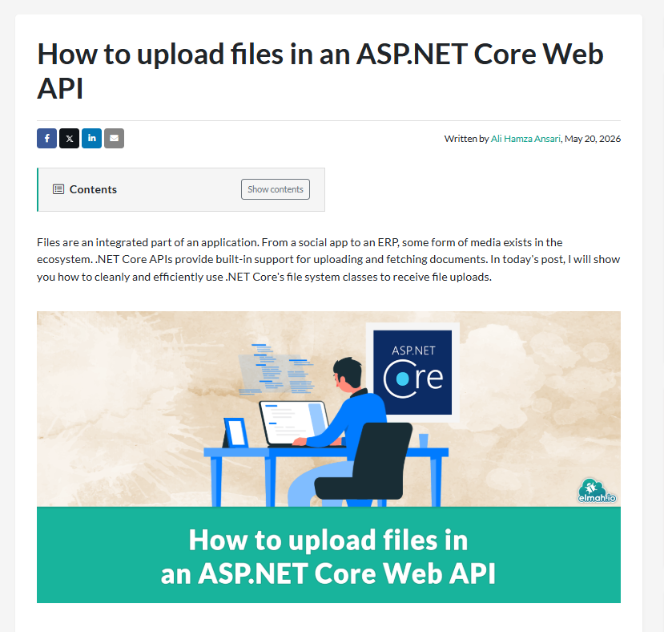
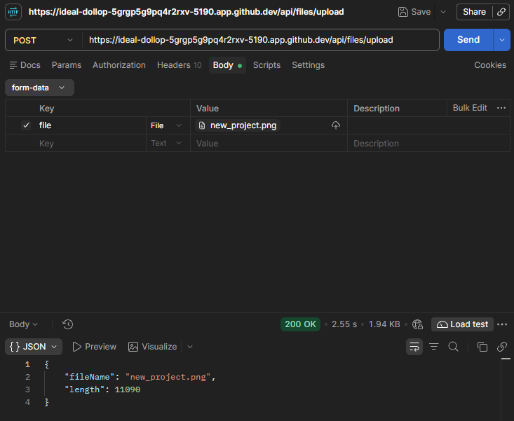
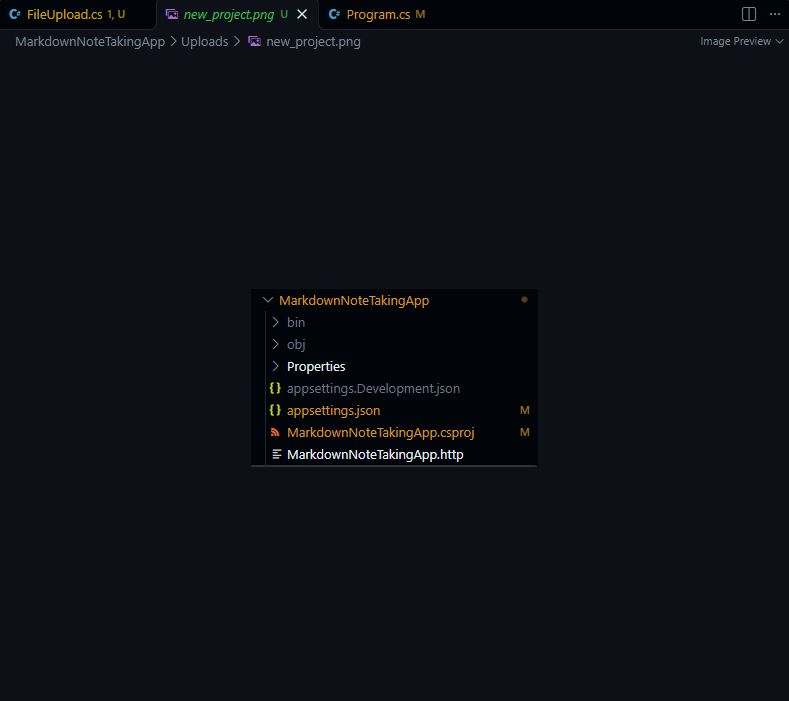

## Tutorial Blog I found

Today I found a [blog](https://blog.elmah.io/how-to-upload-files-in-an-asp-net-core-web-api/) with a tutorial on implementing a simple file upload.


<figcaption>Screenshot of file upload tutorial blog on uploading files in a .NET web API.</figcaption>

<div class="mb-16" />

After reading through it, I made a simple controller with a basic file upload setup, following the code in the blog:

```csharp
using Microsoft.AspNetCore.Mvc;

namespace MarkdownNoteTakingApp.Controllers;

[ApiController]
[Route("api/[controller]")]
public class FilesController : ControllerBase
{
    [HttpPost("upload")]
    public async Task<IActionResult> Upload(IFormFile file)
    {
        if (file == null | file.Length == 0)
            return BadRequest("No file uploaded");

        var uploadsFolder = Path.Combine(Directory.GetCurrentDirectory(), "Uploads");

        if (!Directory.Exists(uploadsFolder))
            Directory.CreateDirectory(uploadsFolder);

        var filePath = Path.Combine(uploadsFolder, file.FileName);

        using (var stream = new FileStream(filePath, FileMode.Create))
        {
            await file.CopyToAsync(stream);
        }

        return Ok(new { file.FileName, file.Length });
    }
}
```
This is a basic file upload setup. I just wanted to get it working first and understand how the process works. After that, we can add things as needed.

## Sample output

I tested the endpoint on postman and uploaded a file. Here is the result:



It created a new Uploads directory within the API and saved the file within that folder:




And here we see the uploaded image.

<div class="mb-16" />

## What it doesn't have yet

The tutorial only stores files locally, or the directory that the API uses. It does not cover storing the files in a third-party storage or filesystem.

This is a really simple implementation, and does not cover security, file type restrictions, size limits, and other considerations.

For this project, I'm planning to have two storage types: a filesystem such as Azure Blog, and a relational store for metadata.

<Callout>
My setup is fully on the cloud. I use GitHub codespace for my editor, the Postman web app, and everything else. So I really do have to use cloud services in all my projects, not locally.
</Callout>

For the next sessions, I'm gonna implement file type and size limits, and then maybe figure out how to get those files into a separate file system or storage.

---

That's it for today's logs. See you in the next sessions!

Blog will be coming out soon, which will mainly be about the file uploading part of this project. That's the first step!

<div class="mb-16" />

<figcaption class="text-left">
**Small side-note**: Our cat was in the way in the whole session, so that 1hr study time might've been around only 45 minutes!
</figcaption>

