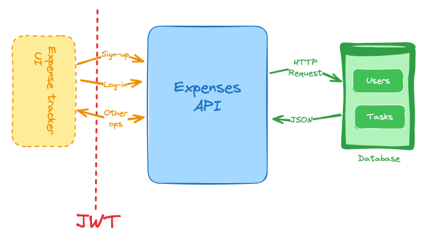
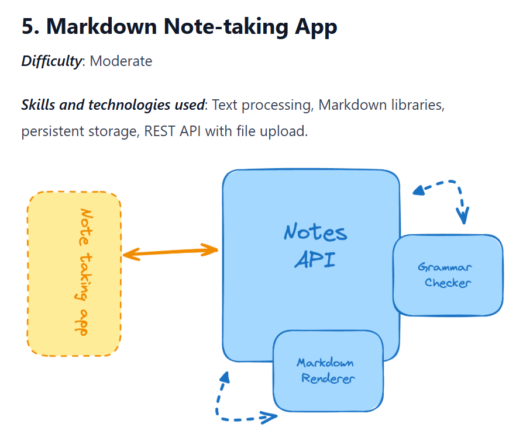

Github repo: [ExpenseTrackerApi](https://github.com/p-ragudo/backend-projects/tree/main/ExpenseTrackerApi)  
I'll be creating a post that is more in-depth for this project.

---

Today I decided to call the project complete, since it has been taking a while now, and I need to move to other projects.

*Project diagram of project 4 in the roadmap. From roadmap.sh*

I didn't do all the requirements specified in the project.However, I needed to prevent this project from taking most of my time. Because of recent schedules, I have not been consistently doing this project,
which is the reason I haven't been consistent with this project, and I need to move on to the next.

## Implementing JWT 

I focused all my energy in implementing JWT, since I have not implemented JWT before.

- implemented access and refresh tokens
- expiration and refresh token rotation
- tokens are stored http only, and are sent as cookies
- raw refresh tokens are not stored on the db, only the hashed version

## Expense Tracker API

I had not focused here, and only implemented basic CRUD endpoints. The focus was really on implementing JWT on protected endpoints.

- Create, Read, Update, and Delete endpoints for expenses
- All endpoints need an access token to access resources

## Things not implemented

**Expired refresh token cleanup on the database**  
Haven't really looked into implementing this, but maybe for next projects.

**Pagination**  
Although I've created a lot of basic CRUD APIs, I have only implemented pagination one time.
Maybe I will implement it as a default for my next projects.

**Query filtering**  
On the GET endpoint again. I'll take the time to learn pagination and query filtering and implement them all
on my projects as a default.

## Next Project
I'm still choosing between continuing with Project 5, or take a "project checkpoint break" where I make my own project
before continuing again with the roadmap

The choices are:

### Project 5 on the Roadmap: Markdown Note-taking App

*Project 5 from roadmap.sh*

### Text Editing with Live Collaboration

I don't know where this idea came from. But I really wanted to do something
with live collaboration.

Since the two have something to do with text editing, maybe I'll combine both.

---

That's it for today's logs. I'll see what next project I will do.