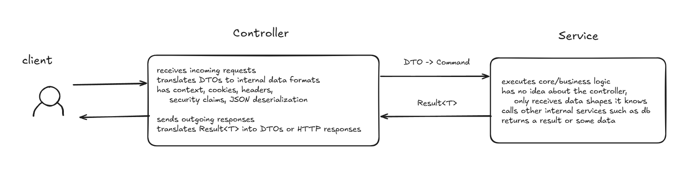

I usually just pass a DTO directly to the service layer, and from then return a value or null, or sometimes throw exceptions from the service back to the controller. 
Until I hit a problem: is it successful? Did it fail? What is the error type? How do I append a message so you can trace exactly what went wrong?

I learned about the `Result<T>` pattern, Commands, and CQRS, on a surface level, although I usually encounter the term CQRS when I normally browse around.

## Controller and Service separation and different data shapes for each
The controller and the service should be handling completely separate tasks. And sometimes, you may need to separate their data shapes or formats. Such as the DTO is only for the controller, and Commands for the service.

In the controller, it should handle receiving and sending requests and responses, as well as translating a DTO to a Command, or a data shape that is intended for the internal application or the service layer.

This separation is not strictly necessary, but there are some cases where your application might need to create this separation.

Then, the service layer should return a standardized `Return<T>` type, and used across the entire application.

## Command Query Responsibility Segregation (CQRS)

I haven't studied much about this, only surface level. But the idea is read and write operations and data shapes should behave differently.

The requirements of read operations are different from write operations, as well as the optimizations for each one.

Though I might need to study up more about this.

---

That's it for today's logs.