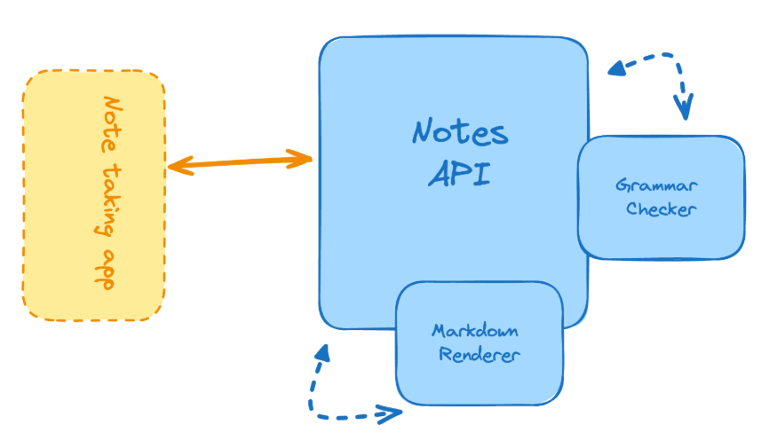

Link to roadmap: https://roadmap.sh/backend/project-ideas

I mentioned from the previous [log](https://paoloragudo.com/blog/logs/expense-tracker-api-project-completion/) whether I would do Project 5, something with text editing and live collaboration, or a mix of both.

With the introduction of file uploads (which I have not yet done before!), I decided to do Project 5 on the roadmap, and just make live-collaboration a separate project in its own.

---

First is the project specifications. One notable difference from previous APIs that I made is the introduction of file uploads.

I’ll have to provide an endpoint for uploading .md files, as well as an endpoint for passing the raw Markdown text inside a JSON body.

In the API, I would also need to provide grammar checking, probably a third-party service. I’d need to clean the markdown format before passing it though.

I would also need to provide a GET endpoint for fetching a cleaned HTML format of the raw markdown.

---

Of course, with the introduction of file uploads come also new security considerations, such as:

- denial of service attacks
- uploading of viruses or malware
- compromise networks and servers in other ways

I found them [here](https://learn.microsoft.com/en-us/aspnet/core/mvc/models/file-uploads?view=aspnetcore-11.0):

[Here](https://www.youtube.com/watch?v=h0JaK7q8A8c) is also a good video on REST API file uploading using IFormFile.

I might also look into more different ways regarding file uploads, and learn more about in general.

---

That’s it for today’s logs.