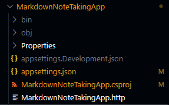
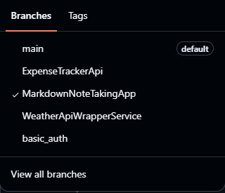

For this study log, I've created a new web api project, and then mainly read about file uploads in MS Learn

## Project Setup

<figcaption>*Screenshot of a newly created web api project*</figcaption>

<figcaption>*Screenshot of a newly created branch in my [backend-projects repository](https://github.com/p-ragudo/backend-projects/tree/MarkdownNoteTakingApp)*</figcaption>

---

## Readings on Microsoft Learn
After that, I mainly just read about file uploads in .NET in MS Learn. 

Link to docs: https://learn.microsoft.com/en-us/aspnet/core/mvc/models/file-uploads?view=aspnetcore-3.1

---

## What I've learned so far

### File uploads can either be buffered or immediately saved

During file uploads, the stream is saved to a temporary disk space — or a buffer — before being saved on the file system.

Problems occur when multiple files are being uploaded at the same time, running out of memory for buffer allocation, hence crashing the app.

For those cases, buffering is skipped, and files are saved immediately on disk. Though, they do not necessarily make the process faster or more efficient. It just saves them directly to disk, skiping the buffer. 

Checkout the posted MS Learn link to learn more about it.

### Do not use user-defined filenames on your storage

The filename that a user uploads should not be used as the filename in your storage. You should use your own defined naming-system. This can eliminate file name collisions and prevent security and vulnerability risks.

You should only use user-defined filenames for display and logging.

<Callout type="warning">
Also, absolutely necessary: you should **not** make files executable.
</Callout>

Having a separate file system or storage aside from the databases/storage makes it easier to put rules and limit permissions on that file system.

### Model bindings and more

I came across this term in the article, though I'm still confused and less informed about this one. So might have to study up on that one for the following study sessions.

There are also some specific things in the article on implementing file uploads, such as IFormFile exceptions on specific cases and more, which I will not go through here.

---

That's it for today's logs.