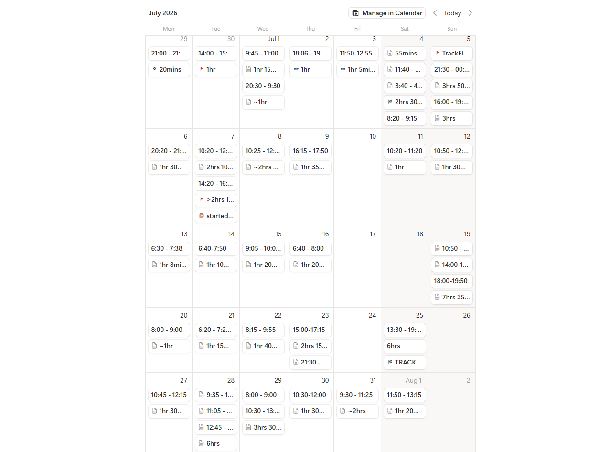
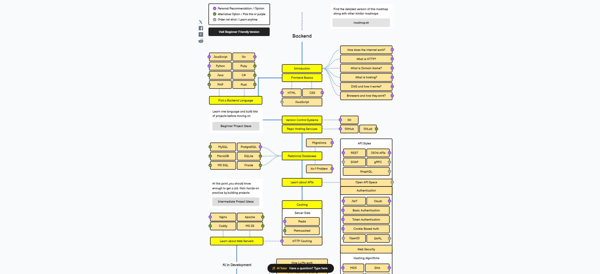
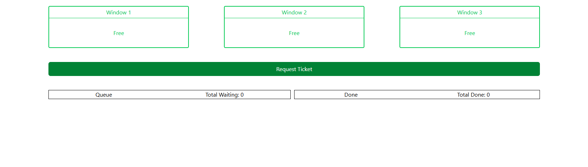
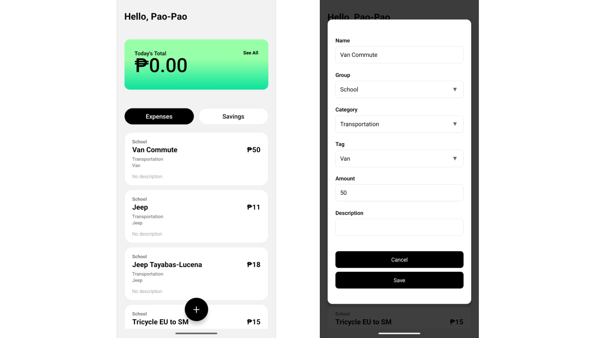
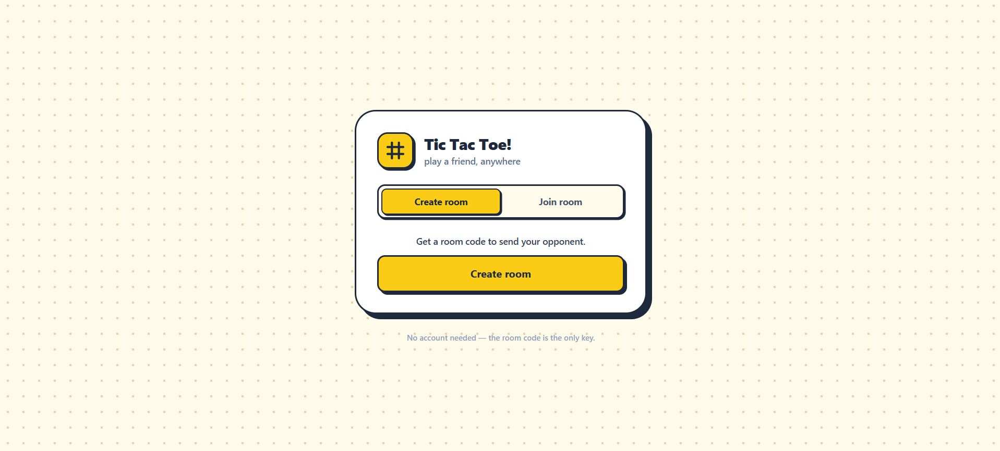
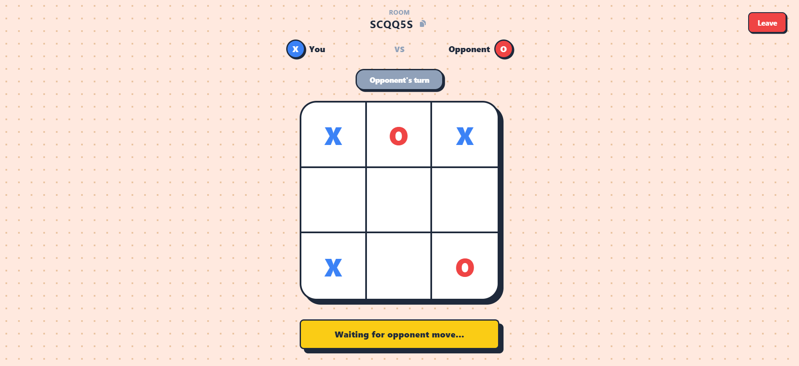
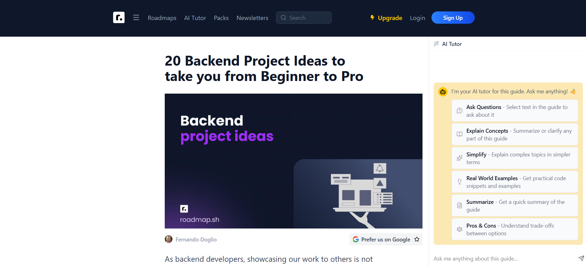

Software Engineering is a broad field. It has web development, cybersecurity, systems programming, Internet of Things, cloud, and many others. In a field as broad as this, deciding which area to specialize in has led me to putting off the question indefinitely. And with graduations nearing, I needed to take a step and make a decision, before the time catches up and suddenly I’m left with sprawling areas that I worked on, and a master to none.

---

## Choosing a niche does not lock me out from others

Perhaps one of the reasons that I couldn’t make a decision was the idea that if I went and specialized in one area, I am locking myself out from other areas. I thought that if I specialized in embedded systems, I would only ever get to work on embedded systems and that alone. But that couldn’t be further from the truth. You still can and will get to work on other areas besides the one you choose. I did not know where this idea came from, but that stopped me from picking a focus and starting early on.

---

## Why I chose Backend and Cloud

### Frontend was a skill-issue

I hated frontend. In frontend, it feels almost chaotic and unstructured. Adding style classes, divs, and then you would get a completely different result from the one you intended. I acknowledge that this is just a skill issue. It is in many ways unpredictable, at least for me.

While I built full stack applications end-to-end before, backend just seemed to be more interesting to me. It’s structured. The answers are definitive and certain, things are more formally standardized, and I really liked that aspect in backend development. 

I also enjoyed designing systems, charts, drawing diagrams, and conceptualizing where and how data will flow from one component to another, how services will perform under different circumstances, and other exciting topics related to designing systems. 

### The thrill of seeing my projects live over the internet

Seeing my projects deployed and live online was really thrilling. Exploring cloud also sparked a curiosity in me — a kind of creative curiosity that for a long time really needed an outlet — that led me into a rabbit hole of looking up Virtual Private Servers (VPS), containers, concurrency, systems, multi-tenancy, reverse-proxy, and many more. It’s also one of the main reasons that really pushed me to finally start a website after wanting to for so long. 

To me, the cloud felt like an extension of the backend (you could even consider it as the backbone, infrastructure, or the plumbing of backend over the internet). It felt like my projects and ideas are not just sitting locally in my laptop, but discoverable and accessible by anyone in the world, and I could actually show it live. It just felt really interesting and exciting to me and I really gravitated towards it.

---

## How it’s going so far

Ever since I made the decision to pick a niche and start really digging deep, I’ve decided that the only way I’m going to make progress and see success is to commit.

### Consistency as my companion

I needed a plan, a schedule, a habit. But to really keep moving forward, I needed to be **CONSISTENT**.

*My daily study logs for July 2026 in Notion.*

So I committed to studying and coding at least one hour every single day (except Sundays). Although some days I skip, and there are occasions where I skip days consecutively, I always try to pick the pace back up again and keep it going.

### A Roadmap

This is one of the early problems I encountered during the first weeks of starting: I didn’t have a roadmap. I would lookup topics and find what to study and build. But without a roadmap to progressively guide me, I was just wandering aimlessly.

*A partial overview of the backend roadmap from roadmap.sh*

And so I started looking at the [roadmap.sh backend roadmap](https://roadmap.sh/backend). It’s a good and fairly comprehensive roadmap and people would repeatedly recommend it. There are also roadmaps for the other areas in software and computer science as well!

The roadmap tells you what topics and skills you’d need to learn and in what order, but it does not mention what projects to make. I can pretty much build anything I want, and I did build things that I want (a ticket queue system, a mobile expense tracker app, an online tic tac toe game), but I also wanted a list of curated projects I wanted to follow along. I found that [this](https://roadmap.sh/backend/project-ideas) was a good list of 20 backend projects that progressively gets harder and more advanced and builds on top of previous projects. As of writing this blog, I am at Project 4 where I’m learning about JWTs and how to implement them in .NET. 

---

## Projects I’ve built so far

Some notable projects I have made over the past 3 months since I’ve started are listed below:

### Ticket Queueing System

I know the frontend looks atrocious, but that wasn’t really the focus of the project. It was to understand how to implement web sockets for real time updates. Each ticket has a random amount of seconds needed to finish that ticket. Instead of a push-pull system like standard queueing systems, the tickets just get assigned automatically to a free worker via a background process. Updates are real time and synced across all clients.

You can checkout the project on GitHub [here](https://github.com/p-ragudo/DotnetProjects).

### Template-based Mobile App Expense Tracker and a Google Sheets spreadsheet as a data store

My daily expenses started to look the same: commute and food; almost the same every single day. So I built an expense tracker app that allows you to make an expense template. 

The design choice to use a spreadsheet was intentional. With just one tap, that expense gets recorded into Google Sheets in my account, which allows me to log expenses in a spreadsheet where I can then later perform analytics and get more insights about my spending using the built-in tools that spreadsheets have, and it saves me the pain of having to build my own analytics and data visualization tools.

Another design choice is instead of the mobile app calling the google sheets API, it talks to a .NET backend that connects to the google sheets API. This might sound like another extra layer, but there are two reasons for this design choice:

**(1)** I wanted to decouple the app from all the logic and processing

**(2)** I wanted to build and deploy a .NET backend. 

For a personal expense tracking app, it does the job alright. You can also find the GitHub repository [here](https://github.com/p-ragudo/DotnetProjects).

### Online Tic-Tac-Toe Pvp Game

I’ve always wanted to make a live tic-tac-toe pvp game ever since I created one in the terminal using Java 2 years ago. But back then, I didn’t have the skills to make one yet, and after a while, it got pushed into the background.

Well, I decided to finally take the step and made it happen. Using the experience with building the ticket queueing system, I implemented web sockets for live gameplay. This, however, added a new layer where real-time updates and syncing are isolated to only connected players.

I also built the backend or server to be client implementation-agnostic. It doesn't matter whether a client is a flashy and polished React frontend, or a simple terminal. As long as they adhere to the server’s contract, a Next.js client and a console client can even play against each other!

I was originally gonna decouple game state from the server using an external memory store such as Redis, but decided that with the current scale of my application, a single monolith deployment would do the job.

Also, this UI doesn’t look half as bad as my previous projects. I call that improvement!

You can actually play the game right now [here](https://tictactoe-icespikes.vercel.app/)!

---

### 20 Backend Projects Roadmap

Not a project, but a set of projects. Right now, I decided to follow a more structural approach. I’m following this [backend roadmap projects](https://roadmap.sh/backend/project-ideas) and slowly building each project, trying to learn and improve. 

Additionally, I paired it with the [backend roadmap in roadmap.sh](https://roadmap.sh/backend). I use the general roadmap for which topics to progressively learn, and the 20 backend projects for what projects to build.

As of writing this blog, I am at **Project #4**, an Expense Tracker API with JWTs as an authentication scheme.

Come check out the [github repo](https://github.com/p-ragudo/backend-projects) if you’re interested!

These projects may seem introductory or amateur-ish, but it’s a start. And as I get better and better, my projects will improve and become more and more complex. The important thing here is to be concistent, and I’ve displayed here that I show up every time. I’m playing the long game.

---

## Future Plans

Learning backend has been fun so far, and hopefully I make a good career out of it. I also plan to get into linux and devops soon, which I think will be more if not as fun. 

Some projects I got lined up next are Redis, Docker, a Git clone, or something entirely my own. Eventually, I also want to start building something that people will use and I will actively maintain. I think there is great value in that.

I believe one of the things that keeps me and will keep me going is the fact that I find it fun, enjoyable, and overall just a really great experience. 

I’m really excited to continue learning, exploring, and to see what things I will build in the future!

---

If you want to follow along my journey, you can visit this blog once a week. I post every Sundays. At the time of writing this article, I have not yet setup a newsletter yet or some form of subscription and content distribution (but I will soon!). 

I repost these articles across blogging platforms such as DEV, Hashnode, and Medium. I also post daily on LinkedIn, X, and sometimes Reddit. 

Thanks for reading to the end!

